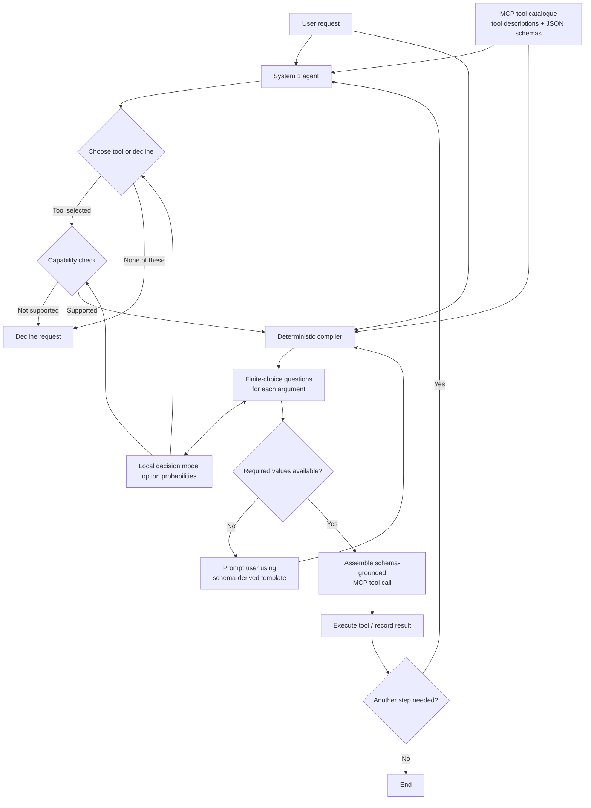

<div align="center">
  

  **Local, reliable and fast agentic AI without text generation**

  *Code, data and results of “System 1 agents: a method for local, reliable and fast agentic AI”*

  [Citation](#citation) · [License](#license)
</div>

---

## What is a System 1 agent?

A System 1 agent calls tools without generating text. A deterministic **compiler** turns a tool's JSON schema and the user's request into typed multiple-choice questions: which tool, which value for each argument, which item comes next in a list. A **decision model** answers each question with a probability for every option, in one forward pass. Code owns the control flow and assembles the call, so every tool name, argument name and value comes from the catalogue, the schema or the request: **the model judges; code assembles**.

The agent declines a request that no tool can do, and asks for a required value the request does not give instead of inventing one. Every question and answer can be stored, so a run can be audited and replayed decision by decision.



How the agent, the compiler and the decision-model back-ends work, and how they were developed: [`docs/ARCHITECTURE.md`](docs/ARCHITECTURE.md).

## Key results

Six System 1 agents were compared with nine local LLM agents, each with reasoning on and off, on 157 MCP tools from 18 medical-imaging and biomedical servers ([evaluation set](data/README.md)):

- **Accuracy:** the best System 1 agent made 93.9% of requests fully correct, the best LLM agent 91.3%. Over the 108 System 1 × LLM pairs, System 1 was significantly ahead in 73 and the LLM in 11.
- **No invented content:** no invented tool, argument or value was detected in 10,888 System 1 calls; 5.5–19.7% of the LLM agents' calls contained at least one (lower bound).
- **Missing values:** the System 1 agents handled 86.2–93.7% of underspecified requests correctly (right tool, stated values right, the missing value left for the user), the LLM agents 0.0–5.7%.
- **Cost:** the OpenJev System 1 agent took 2.6 s per request and 0.228 Wh per fully correct request; Qwen3.5-27B with reasoning off took 4.5 s and 0.413 Wh.

Every table of the paper is in [`results/analysis/tables.md`](results/analysis/tables.md).

## Repository layout

| Folder | Contents |
|---|---|
| [`code/`](code/) | the System 1 agent (agent, compiler, decision-model back-ends), the LLM-agent baseline, the scorer, and scripts to run, replay and analyse; see [`code/README.md`](code/README.md) |
| [`data/`](data/) | the evaluation requests with their labels, and the two MCP tool catalogues; see [`data/README.md`](data/README.md) |
| [`results/`](results/) | every agent's records, the stored decision-model answers, the LLM completions, the analysis outputs and the fabrication review |
| [`figures/`](figures/) | the manuscript figures (PDF, SVG, PNG) |
| [`docs/ARCHITECTURE.md`](docs/ARCHITECTURE.md) | how a System 1 agent works, and the method used to develop it |
| [`.claude/skills/reproduce-results/`](.claude/skills/reproduce-results/) | a skill that guides a coding agent (for example Claude Code) through reproducing the results |

## Requirements

| To | You need |
|---|---|
| reproduce the paper's results | Python 3.11 or later (3.12 was used) and Node.js (24 was used; the biomedical scorer runs the ClinicalTrials.gov server's own normalisers). A CPU is enough. |
| run System 1 agents | in addition, llama.cpp's `llama-server` and an NVIDIA GPU with room for the decision model (from 7.2 GiB for decider-4b; see [the models](#2-get-llamacpp-and-a-decision-model)) |

The commands below are for a Linux shell; on Windows, use WSL. The study ran on Ubuntu 24.04.

## Reproduce the paper's results (CPU, a few minutes)

This rebuilds every System 1 call from the stored model answers, rescores every agent, and regenerates the tables, the fabrication analysis, Table 1 and the figures.

```bash
git clone https://github.com/eltzanis/SystemOneAgents && cd SystemOneAgents
(cd data && sha256sum -c --quiet SHA256SUMS.txt) && (cd results && sha256sum -c --quiet SHA256SUMS.txt)   # files intact
cd code
conda create -n s1agents python=3.12 && conda activate s1agents
pip install -e ".[test,figures]"                     # exact versions used: pip install -r requirements-lock.txt
python -m pytest                                      # no GPU, no model

# replay: rebuild every System 1 call from the stored answers, compare with the released records
python scripts/replay_s1.py --catalogue ../data/catalogues/imaging_tools.json \
    --data ../data/requests/imaging_test.jsonl ../data/requests/external.jsonl \
    --answers ../results/system1/answers --records ../results/system1/records
python scripts/replay_s1.py --catalogue ../data/catalogues/biomedical_tools.json \
    --data ../data/requests/biomedical_test.jsonl \
    --answers ../results/system1/answers --records ../results/system1/records

# analysis: every table of the manuscript
python scripts/analyse.py --sensitivity --out runs/analysis

# fabrication analysis (Fig. 4a, Extended Data Table 7)
python scripts/fabrication.py --check-sample --out runs/fabrication

# Table 1: System 1 against LLM agents, category by category
python scripts/scorecard.py --out runs/scorecard

# figures
python scripts/figures.py --out runs/figures
```

What each step should give:

| Step | Expected |
|---|---|
| checksums | no output |
| tests | 61 passed, 3 skipped (the three need decider-35b-a3b's tokenizer files) |
| replay | for each of the six models, every request identical and 0 missing answers (1,179 imaging, 123 external, 824 biomedical) |
| analysis | `runs/analysis/metrics.json` equal to `results/analysis/metrics.json`; in `tables.md`, fully correct requests over the 108 pairs: 73 System 1 ahead, 11 LLM ahead, 24 no significant difference |
| fabrication, Table 1 | `diff -r runs/fabrication ../results/fabrication` and `diff -r runs/scorecard ../results/scorecard` print nothing |
| figures | `runs/figures/figure_data.json` equal to `figures/figure_data.json`. The PNGs are byte-identical to those in `figures/` when the fonts they were drawn with are installed (see below) |

The figures were drawn with Liberation Sans and Liberation Mono 2.1.5 and URW Nimbus Sans, which the study's Ubuntu 24.04 desktop had. Without them, matplotlib falls back to another font: the plotted values stay the same, but the lettering and so the PNG files differ. On a minimal Ubuntu 22.04 (for example WSL), `sudo apt install fonts-liberation2 fonts-urw-base35` gave byte-identical PNGs.

To have a coding agent run and check all of this, open the repository in Claude Code and ask it to reproduce the results: it uses the [`reproduce-results`](.claude/skills/reproduce-results/SKILL.md) skill.

## Build a System 1 agent for your own tools

### 1. Install

```bash
cd code
pip install -e .
```

### 2. Get llama.cpp and a decision model

The agent reads its decision model from llama.cpp's `llama-server`. The study used release b11929; [`code/README.md`](code/README.md#llamacpp) gives the download commands and checksums. Its paths are set at the top of [`code/configs/models.yaml`](code/configs/models.yaml) (`llama_server`, `cuda_libs`): change them to use your own build.

The six decision models of the study, all used without fine-tuning (measured on the study's GPU, over the evaluation set):

| `--model` | Model | Fully correct | s per request | Peak GPU memory |
|---|---|---:|---:|---:|
| `decider-4b` | decider 4B | 81.4% | 1.2 | 7.2 GiB |
| `pplx-decider-flash` | Perplexity pplx-decider-flash 4B | 89.8% | 4.6 | 12.0 GiB |
| `decider-35b-a3b` | decider 35B-A3B (mixture of experts) | 86.7% | 2.2 | 22.9 GiB |
| `openjev` | OpenJev | 92.9% | 2.6 | 21.3 GiB |
| `clef` | Cloudflare Clef 27B | 91.1% | 3.1 | 30.4 GiB |
| `pplx-decider-27b-embed` | Perplexity pplx-decider 27B | 93.9% | 10.1 | 34.2 GiB |

`decider-4b` is the quickest to try; OpenJev and pplx-decider-27b were the most accurate. Check each model's licence on its model card: OpenJev is CC-BY-NC-4.0 (non-commercial), and the Perplexity models may require accepting their terms on Hugging Face.

Model files go to `code/models/<folder>/`, with the folders of [`code/configs/models.yaml`](code/configs/models.yaml). For decider-4b, from `code/`:

```bash
hf download Mapika/decider-4b-GGUF decider-4b-v3-Q8_0.gguf tokenizer.json tokenizer_config.json decider_config.json \
    --revision d3a78581751d518bbfa9e871a6d84059554d53c5 --local-dir models/decider-4b
sha256sum models/decider-4b/decider-4b-v3-Q8_0.gguf   # d29bda3381301c81d1ecaf8adf2f9df94f724f0179be4ddb11c898f38713ffd0
```

The sources, revisions and checksums of the other models are in [`code/README.md`](code/README.md#decision-models-system-1).

### 3. Start the model's server

```bash
s1a serve decider-4b        # llama-server on 127.0.0.1, port from configs/models.yaml; leave it running
```

### 4. Try it on the study's tools

```bash
s1a plan "Segment the liver and the spleen in /data/ct/p01.nii.gz" \
    --catalogue ../data/catalogues/imaging_tools.json --model decider-4b
```

`plan` selects a tool and fills its arguments without calling anything. It prints every decision (question, top options, probabilities) and the resulting call, and appends the decisions to `runs/traces/`.

### 5. Connect your own MCP servers

List your servers in a YAML file as in [`code/configs/servers.example.yaml`](code/configs/servers.example.yaml) (each one started over stdio with `command`, `args`, and optionally `cwd` and `env`). Then save their tools as a catalogue and use it:

```bash
s1a catalog --servers my_servers.yaml --out my_tools.json      # start each server once and save its tools
s1a plan "..." --catalogue my_tools.json --model decider-4b    # dry run: decisions and call, nothing executed
s1a run "..." --catalogue my_tools.json --servers my_servers.yaml --model decider-4b
```

`run` plans the call, asks you for any required value the request does not give, asks for confirmation (`--yes` skips it) and calls the tool. `--max-steps N` lets the agent continue with further calls after the first. `--args-model` uses a second decision model for the argument questions.

### 6. Tune the agent

[`code/configs/agent.yaml`](code/configs/agent.yaml) holds the agent's settings (pass another file with `--settings`):

| Setting | Study value | Meaning |
|---|---|---|
| `select_min_conf` | 0.3 | below this selection confidence the agent declines |
| `optional_min_conf` | 0.7 | an optional value is set only when P(the request gives it) reaches this |
| `list_min_conf` | 0.7 | the same bar for a list's first item |
| `policy_defaults` | `output_dir: "{workspace}/{tool}_{timestamp}"` | values for arguments the request leaves open; never shown to the model |
| `workspace` | `runs/workspace` | the folder `{workspace}` stands for |

### 7. Use it from Python

```python
from s1agent import build_agent

agent = build_agent("decider-4b", "../data/catalogues/imaging_tools.json")   # the model's llama-server must be running
plan = agent.plan("Segment the liver in /data/ct/p01.nii.gz")
if plan.filled is None:
    print("declined: no tool fits, or the selection confidence is below select_min_conf")
else:
    print(plan.selection.tool.name, plan.selection.confidence)
    print(plan.filled.args, plan.filled.missing)   # the call's arguments, and required values the request does not give
```

### Add another decision model

A model that `llama-server` can serve with one of the three supported read-outs is one more entry in [`code/configs/models.yaml`](code/configs/models.yaml): `decider-llamacpp` (log-probabilities of the option labels), `pplx-llamacpp` (hidden state at a read-out marker) or `systemone-llamacpp` (llama-server's own decision endpoint). Any other model needs a back-end: a subclass of `Backend` in [`code/src/s1agent/backends/`](code/src/s1agent/backends/) whose `_choice(state, question, options, kind)` returns a probability for each option. [`lexical.py`](code/src/s1agent/backends/lexical.py) is the shortest example.

## Rerun the experiments (GPU)

Rerunning the System 1 and LLM agents needs llama.cpp b11929 and the model files. [`code/README.md`](code/README.md) gives their sources, revisions and checksums, and the run commands (`scripts/run_s1.py`, `scripts/run_llm.py`). The runs used one NVIDIA RTX PRO 5000 Blackwell (48 GB) on Ubuntu 24.04.

A decision model gives the same answer to the same question on the same hardware and build. On other hardware, small differences in the last digits of the probabilities can change a few close decisions: in a check on 117 requests, 0–2 verdicts per model differed between the study's GPU and an RTX 2080 Ti.

## Citation

**Tzanis, E. & Klontzas, M. E.** *System 1 agents: a method for local, reliable and fast agentic AI.* (2026).

```bibtex
@misc{tzanis2026system1,
  title  = {System 1 agents: a method for local, reliable and fast agentic AI},
  author = {Tzanis, Eleftherios and Klontzas, Michail E.},
  year   = {2026}
}
```

## License

- **Code:** Apache License 2.0; see [`LICENSE`](LICENSE).
- **Third-party code in `code/src/s1eval/data/`:** the ClinicalTrials.gov and ChEMBL normalisers are Apache-2.0; the scikit-learn stop-word list is BSD-3-Clause. The licence files are next to them; see [`code/src/s1eval/data/README.md`](code/src/s1eval/data/README.md).
- **MCP servers:** not included; the catalogues are JSON snapshots of their tool lists.
- **Models:** not redistributed. Each model's own licence applies.
- **External requests:** taken verbatim from the published mAIstro and ReCLAIM notebooks.

## Authors and contact

- **Eleftherios Tzanis, PhD** — corresponding author: [eleftherios.tzanis@ki.se](mailto:eleftherios.tzanis@ki.se) · [etzanis@uoc.gr](mailto:etzanis@uoc.gr)
- **Michail E. Klontzas, MD, PhD, EDiR**

Artificial Intelligence and Translational Imaging (ATI) Lab, Department of Radiology, School of Medicine, University of Crete, Heraklion, Crete, Greece; Division of Radiology, CLINTEC, Karolinska Institutet, Huddinge, Sweden; Department of Medical Imaging, University Hospital of Heraklion, Crete, Greece.

## Funding

Funded by the European Union under Horizon grant agreement **No. 101287679**. The views and opinions expressed are those of the authors and do not necessarily reflect those of the European Union or the European Research Executive Agency (REA). Neither the European Union nor REA can be held responsible for them.
