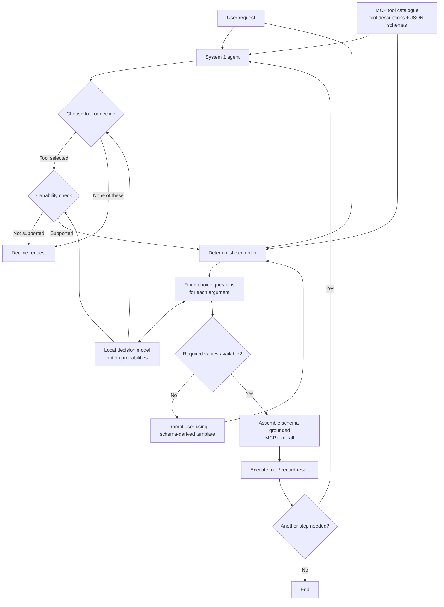

<div align="center">
  

  **Local, reliable and fast agentic AI without text generation**

  *Research implementation accompanying “System 1 agents: a method for local, reliable and fast agentic AI”*
</div>

---

## Overview

**System 1 Agents** is a method for building locally deployed agents that select tools and construct tool calls **without generating text**. Instead of asking a large language model (LLM) to write a tool call token by token, the method uses a **decision model** to choose among finite options generated by a deterministic compiler.

The key principle is simple: **the model judges; code assembles and executes the selected values.** Tool names come from the tool catalogue, argument names come from a tool's JSON schema, and argument values are selected from the request, schema, documented transformations, environment or predefined agent policy. The architecture is intended to reduce invented content, make uncertainty explicit and permit question-by-question auditing.

The method was evaluated on **157 tools from 18 Model Context Protocol (MCP) servers** covering medical imaging and biomedical research, against **nine local LLM-based agents evaluated with reasoning on and off**.

> **Scope of the claims:** “No invented content” describes the reported grounding assessment of tool calls in this study. It does not mean that the agent always selects the correct tool or assigns every grounded value to the correct argument.

## Results at a glance

| Measure | Reported result |
|---|---:|
| Evaluation requests, total | **2,249** |
| Main accuracy benchmark | **1,952** requests: 1,645 complete + 307 out-of-scope |
| Stated argument values in complete requests | **6,056** |
| Underspecified requests | **174** |
| MCP tools / servers | **157 / 18** |
| System 1 decision models | **6** |
| LLM agent configurations | **18** (9 models × 2 reasoning settings) |
| Best System 1 tool-calling accuracy | **97.0%** |
| Best System 1 argument-filling accuracy | **97.0%** |
| Best System 1 fully correct requests | **93.9%** |
| Invented content in System 1 calls | **0 detected in 10,888 calls** |
| Ungrounded values in System 1 calls | **0 detected among 33,945 argument values** |

**Accuracy comparison on the main benchmark:**

| Agent | Tool calling | Argument filling | Fully correct requests |
|---|---:|---:|---:|
| **System 1 · pplx-decider-27b** | **97.0%** | 97.0% | **93.9%** |
| **System 1 · OpenJev** | 96.1% | 96.1% | 92.9% |
| LLM · Qwen3.5-27B (reasoning off) | 95.1% | **97.2%** | 91.3% |

For fully correct requests, System 1 significantly outperformed the LLM-based setting in **73 of 108** paired comparisons; the LLM setting significantly outperformed System 1 in 11, with no significant difference in 24 (Holm-adjusted comparisons).

**Efficiency at the high-accuracy end of the comparison:** OpenJev-based System 1 completed requests in **2.6 s** with **0.228 Wh per fully correct request**, versus **4.5 s** and **0.413 Wh** for Qwen3.5-27B with reasoning off. These values were measured on the study hardware; they are not hardware-independent speed or energy guarantees.

## How it works



### Three components

**1. Agent — workflow and tool selection.** The agent presents all available tools and a “none of these” option to the decision model. It may compare the parameter names of two close candidates, checks whether the selected tool can fulfill the request, and declines unsupported tasks. In deployment it also uses a confidence threshold to decline uncertain selections. Required missing values trigger a fixed, schema-derived user prompt rather than an invented default.

**2. Compiler — deterministic argument construction.** The compiler reads the selected tool's JSON schema and converts arguments into finite-choice questions. It handles enumerations, booleans, numbers, paths, columns, free text, lists, arrays and objects. Candidate values are extracted from the request and schema or constructed using deterministic transformations such as unit conversions and path composition. The compiler does **not** invent new free-form strings.

**3. Decision model — probability over options.** A decision model receives a state, a question, an option list and a question kind. It returns probabilities over those options in a forward pass, without generating an answer as free-form text. The method is designed to allow different decision-model families to use this same interface.

### Uncertainty and missing values

- The agent can select **“none of these”** and decline unsupported requests.
- Optional arguments require sufficient confidence; documented defaults are generally omitted rather than repeated.
- If a required value is missing or uncertain, the user is prompted using the argument name and schema description.
- Every question and model answer can be stored for replay and audit.

The paper reports that **86.2–93.7%** of underspecified requests were correctly handled by the six System 1 agents, compared with **0.0–5.7%** for the LLM-based settings, under the study's evaluation rules.

## Supported research domains in the evaluation

The tested catalogue contains **42 tools across 11 medical imaging MCP servers** and **115 tools across 7 biomedical MCP servers**.

| Area | Examples included in the paper |
|---|---|
| Medical imaging | 2D/3D image classification, nnU-Net, Merlin CT foundation model, PyRadiomics, TotalSegmentator |
| Machine learning | PyCaret classification/regression, feature importance, exploratory data analysis, model comparison |
| Proteomics | `proteomics-mcp` |
| Genomics | AlphaGenome |
| Metabolomics | MSMCP |
| Single-cell and spatial transcriptomics | Scanpy, TISSUE |
| Clinical research | ClinicalTrials.gov |
| Chemistry | ChEMBL |

These are **evaluated tool integrations**, not a claim that every one is installed automatically in a fresh checkout. External MCP servers and their dependencies may need separate setup.

## Decision models

The study used six published decision models, with no fine-tuning:

| Model | Protocol family |
|---|---|
| `decider-4b` | decider |
| `decider-35b-a3b` | decider |
| `pplx-decider-flash` | pplx-decider |
| `pplx-decider-27b` | pplx-decider |
| `OpenJev` | native SystemOne |
| `Clef` | native SystemOne |

Model inference was served locally through **llama.cpp** (study build **b11929**). Model-specific prompt layouts and probability read-outs are described in the paper, in [`code/src/s1agent/backends/`](code/src/s1agent/backends/) and in [`code/configs/models.yaml`](code/configs/models.yaml). The evaluation used a single **NVIDIA RTX PRO 5000 Blackwell 48-GB GPU**, Ubuntu 24.04, 32 CPU threads and 62 GB system memory. These describe the **experimental setup**, not necessarily minimum hardware requirements.

## Repository layout

| Folder | Contents |
|---|---|
| [`code/`](code/) | the System 1 agent (agent, compiler, decision-model back-ends), the LLM-agent baseline, the scorer, and scripts to run, replay and analyse; see [`code/README.md`](code/README.md) |
| [`data/`](data/) | the evaluation requests with their labels, and the two MCP tool catalogues; see [`data/README.md`](data/README.md) |
| [`results/`](results/) | every agent's records, the stored decision-model answers, the LLM completions, the analysis outputs and the fabrication review |
| [`figures/`](figures/) | the manuscript figures (PDF, SVG, PNG) |
| [`docs/ARCHITECTURE.md`](docs/ARCHITECTURE.md) | how a System 1 agent works, and the method used to develop it |
| [`.claude/skills/reproduce-results/`](.claude/skills/reproduce-results/) | a skill that guides a coding agent (for example Claude Code) through reproducing the results |

## Reproducing the evaluation

### Reproduce the results without a GPU

Everything below runs on a CPU in minutes. It rebuilds every System 1 call from the stored model answers, rescores
every agent, and regenerates the tables.

```bash
git clone https://github.com/eltzanis/SystemOneAgents && cd SystemOneAgents
(cd data && sha256sum -c --quiet SHA256SUMS.txt) && (cd results && sha256sum -c --quiet SHA256SUMS.txt)   # files intact
cd code
conda create -n s1agents python=3.12 && conda activate s1agents
pip install -e ".[test,figures]"                     # exact versions used: pip install -r requirements-lock.txt
python -m pytest                                      # no GPU, no model

# replay: rebuild every System 1 call from the stored answers, compare with the released records
python scripts/replay_s1.py --catalogue ../data/catalogues/imaging_tools.json \
    --data ../data/requests/imaging_test.jsonl ../data/requests/external.jsonl \
    --answers ../results/system1/answers --records ../results/system1/records
python scripts/replay_s1.py --catalogue ../data/catalogues/biomedical_tools.json \
    --data ../data/requests/biomedical_test.jsonl \
    --answers ../results/system1/answers --records ../results/system1/records

# analysis: every table of the manuscript
python scripts/analyse.py --sensitivity --out runs/analysis

# fabrication analysis (Fig. 4a, Extended Data Table 7)
python scripts/fabrication.py --check-sample --out runs/fabrication

# Table 1: System 1 against LLM agents, category by category
python scripts/scorecard.py --out runs/scorecard

# figures (needs the figures extra: pip install -e ".[figures]")
python scripts/figures.py --out runs/figures
```

Each step writes to `code/runs/`, and its outputs equal the released ones: `results/analysis/` (every table and
statistic), `results/fabrication/`, `results/scorecard/` (Table 1), and the figures in `figures/`. The figures plot values from `results/analysis/metrics.json`
and `results/fabrication/`; `figures/figure_data.json` holds the quantities the figure script computes itself (bootstrap
intervals of argument filling, declines by out-of-scope kind).

The biomedical scorer runs the ClinicalTrials.gov server's own normalisers, so Node.js must be on the PATH.

### Reproduce the runs

Rerunning the agents needs llama.cpp (release b11929) and the model files. [`code/README.md`](code/README.md) gives sources, revisions
and checksums. The runs used one NVIDIA RTX PRO 5000 Blackwell (48 GB). A decision model gives the same answer to the
same question on the same hardware and build. On other hardware, small differences in the last digits of the
probabilities can change a few close decisions: in a check on 117 requests, 0–2 verdicts per model differed between
the final GPU and an RTX 2080 Ti.

### Use the System 1 agent on your own tools

From `code/`, after installing as above, and with llama.cpp and a decision model set up as [`code/README.md`](code/README.md) describes:

```bash
s1a serve decider-4b &                                    # llama-server of a model in configs/models.yaml
s1a plan "Segment the liver and the spleen in /data/ct/p01.nii.gz" \
    --catalogue ../data/catalogues/imaging_tools.json --model decider-4b
s1a catalog --servers my_servers.yaml --out my_tools.json # list the tools of your MCP servers
s1a run "..." --catalogue my_tools.json --servers my_servers.yaml --model decider-4b   # also calls the tool
```

`plan` prints every decision (question, top options, probabilities) and the call. MCP servers are declared as in
[`code/configs/servers.example.yaml`](code/configs/servers.example.yaml); agent settings are in
[`code/configs/agent.yaml`](code/configs/agent.yaml). In Python: `from s1agent import build_agent`.

### Dataset composition

The **2,249** requests comprise **2,126 custom prompts** and **123 requests taken verbatim from published research studies**. The custom prompts include:

- **1,645 complete** requests, containing **6,056** stated argument values
- **307 out-of-scope** requests (far, near or unsupported modality)
- **174 underspecified** requests with at least one missing required argument

The primary accuracy analyses use the **1,952 complete + out-of-scope requests**. Missing-required-value behavior is evaluated separately on the 174 underspecified requests. The paper reports exact paired statistical testing with Holm correction, and sensitivity analyses for alternative value-matching rules.

The requests in [`data/`](data/) are this evaluation set: every out-of-scope request, every underspecified request, and
every complete request whose stated values the System 1 compiler can express. The last condition is checked with the
compiler oracle in [`code/scripts/oracle.py`](code/scripts/oracle.py).
Supplementary Table 1 of the manuscript gives the results on all complete requests.

### Reproducibility and auditing

In the reported experiments, answers were stored under a SHA-256 hash of the model, question kind, state, question and options. With the same model, hardware and llama.cpp build, the authors report deterministic responses and exact replay of the stored System 1 records. The paper reports successful reconstruction of **12,756 System 1 evaluation records** and regeneration of the results from the released files; the commands above repeat both from this repository.

## Limitations

System 1 Agents can still **select the wrong tool**, assign a stated value to the wrong argument or make schema-invalid calls. The paper recorded **22 schema-form errors among 10,888 System 1 calls**. Certain near-scope or input-modality mismatches were challenging for all evaluated agents. The reported grounding assessment also treats text present anywhere in the request as grounded, and therefore may undercount invented content relative to a stricter semantic assessment.

The benchmarks focus on tool selection and argument filling in a biomedical catalogue. Results should not be interpreted as evidence that an agent independently performs error-free multistep biomedical research or that local deployment alone guarantees compliance with clinical data-protection requirements.

## Paper and citation

**Tzanis, E. & Klontzas, M. E.** *System 1 agents: a method for local, reliable and fast agentic AI.* Research manuscript (2026).

> A publication DOI, arXiv identifier and BibTeX entry can be added when the manuscript's public bibliographic record is available. No identifier has been assumed here.

## Authors and contact

- **Eleftherios Tzanis, PhD** — corresponding author: [eleftherios.tzanis@ki.se](mailto:eleftherios.tzanis@ki.se) · [etzanis@uoc.gr](mailto:etzanis@uoc.gr)
- **Michail E. Klontzas, MD, PhD, EDiR**

Artificial Intelligence and Translational Imaging (ATI) Lab, Department of Radiology, School of Medicine, University of Crete, Heraklion, Crete, Greece; Division of Radiology, CLINTEC, Karolinska Institutet, Huddinge, Sweden; Department of Medical Imaging, University Hospital of Heraklion, Crete, Greece.

## Funding

Funded by the European Union under Horizon grant agreement **No. 101287679**. The views and opinions expressed are those of the authors and do not necessarily reflect those of the European Union or the European Research Executive Agency (REA). Neither the European Union nor REA can be held responsible for them.

## License

- **Code:** Apache License 2.0; see [`LICENSE`](LICENSE).
- **Third-party code in `code/src/s1eval/data/`:** the ClinicalTrials.gov and ChEMBL normalisers are Apache-2.0; the
  scikit-learn stop-word list is BSD-3-Clause. The licence files are next to them; see
  [`code/src/s1eval/data/README.md`](code/src/s1eval/data/README.md).
- **MCP servers:** not included; the catalogues are JSON snapshots of their tool lists.
- **Models:** not redistributed. Each model's own licence applies: OpenJev is CC-BY-NC-4.0, and the Perplexity models
  may require accepting their terms on Hugging Face.
- **External requests:** taken verbatim from the published mAIstro and ReCLAIM notebooks.
